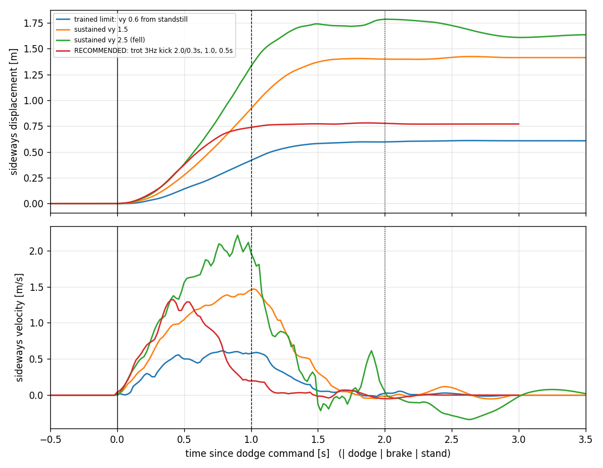

# Go2 sideways dodge in MuJoCo

A fast sideways step for the Go2 under our own low-level control (joint targets at 50 Hz, joint PD on the motors), ending in a still, four-foot stand. Everything runs on the CPU in WSL. There is no NVIDIA GPU here, so Isaac Sim/Gym are not an option.

## Starting point

| Piece | Source | Why |
|---|---|---|
| Walking policy | [walk-these-ways-go2](https://github.com/Teddy-Liao/walk-these-ways-go2) (pretrained Go2) | Public, already deployed on a real Go2. It is gait-conditioned: besides vx/vy/yaw you command step frequency, gait, footswing height and stance width. It only needs IMU gravity and joint states, so no velocity estimator is required. |
| Robot model | [unitree_mujoco](https://github.com/unitreerobotics/unitree_mujoco) `go2.xml` | Unitree's official MJCF. Its DDS bridge speaks the same `LowCmd`/`LowState` as the real dog. |
| SDK | [unitree_sdk2_python](https://github.com/unitreerobotics/unitree_sdk2_python) + CycloneDDS 0.10 | Same API sim ↔ dog. Installed, but not yet used by the dodge script. |

`unitree_rl_gym` ships no Go2 policy (only G1/H1), and `unitree_rl_mjlab` needs you to train first. [go2_dodge_sim.py](go2_dodge_sim.py) copies the walk-these-ways Go2 deploy code exactly: observation layout, scaling, gait clock, action scale, kp=20 / kd=0.5. So the commands simulated here are the ones that repo sends to the dog.

## 3D viewer (native Windows)

The WSLg window does not appear on this machine, so the viewer runs natively on Windows. For speed it plays back a pre-simulated recording, with a time slider and speed controls. It also draws decimated copies of the Go2 meshes, generated on first run into `go2/assets_lowpoly`: about 17k instead of 197k triangles per dog, which takes a frame from about 380 ms to about 21 ms. The physics never uses these meshes. It uses a Python 3.12 venv plus a copy of the Go2 model and policy in `C:\Users\diffr\go2_sim`. The sim scripts give the same numbers there as in WSL (MuJoCo 4.0.1 vs 3.17).

```powershell
powershell -ExecutionPolicy Bypass -File scripts\install_go2_sim_windows.ps1   # once, after the WSL install
powershell -ExecutionPolicy Bypass -File scripts\show_dodges.ps1               # -Speed 0.25 for slower, 1 = real time
```

## Install / run (WSL Ubuntu-22.04)

```bash
bash /mnt/c/Users/diffr/code/AI-Robotics-Berlin/scripts/install_go2_sim.sh   # once
. /root/go2_sim/venv/bin/activate
cd /mnt/c/Users/diffr/code/AI-Robotics-Berlin

python sim/show_dodges.py --snapshot frame.png         # viewer layout as a still frame (live window: see above)
python sim/go2_dodge_sim.py --recommended              # hand-tuned dodge, prints metrics
python sim/go2_dodge_sim.py --recommended --rand 30    # robustness over randomized physics
python sim/go2_dodge_sim.py --sweep --plot sim/results/sweep.png
python sim/go2_dodge_sim.py --vy 1.0 --freq 4 --kick-vy 2.0 --kick-s 0.3 --dodge-s 0.5
cd sim && python optimize_dodge.py                     # full optimization (~4 min, 14 cores) -> results/optimize.json
```

Scenario: settle → trot in place (or `--from-stand`) → **dodge** (lateral command) → brake (zero command) → stand (PD hold of the default pose, ramped in over 0.4 s). "Stable" means no fall, all four feet down, roll and pitch < 5°.

## Viewer

[show_dodges.py](show_dodges.py) puts the dogs in a grid, one dodge each, all triggered at the same moment. Each dog has a coloured ball. Each lane has a white start line and a red 30 cm line. The overlay shows each dog's time to 30 cm, or FELL. The line-up: trained limit, sustained 1.5, sustained 2.5 (falls), hand-tuned, and the two optimizer finalists, which are read from `results/optimize.json`.

## SAFE dodge: the one to put on the robot

`results/safe_dodge.json`, shown in white in the viewer. It is chosen for low crash risk, not top speed:

1. **Harsh, deployment-like runs** (`go2_dodge_sim.harsh_physics`): sensor noise at legged_gym levels, joint targets clamped 0.1 rad inside each joint range (the deploy script must do the same), the trigger at a random gait phase, trunk mass −1…+3 kg, motors at 80–100 %, 0–30 ms latency, friction 0.35–1.1.
2. **Hard load limits**, set at 1.25× the worst of normal sideways walking (0.6 m/s) under the same conditions (`validate_dodge.py --reference`, written to `results/safety_reference.json`): joint ≥ 0.05 rad from its stop, foot force ≤ 1.81 body weights, touchdown p95 ≤ 3.73 m/s, trunk ≤ 1.93 g, torque ≤ 97 % of the motor limit, tilt ≤ 20°. A run also fails if the dog falls or does not end standing still.
3. **`optimize_dodge.py --safe`** searched with these limits. The best finalists still failed 1–3 % of runs, by small limit overshoots, not falls. So **`validate_dodge.py --scale-sweep`** scales their speed commands down until a version passes every run, and the 80 % version was taken for extra margin.

| 500 fresh harsh runs (same set for all) | Failures | 30 cm median / p95 | Worst knee margin | Worst torque | Worst tilt |
|---|---|---|---|---|---|
| **SAFE** (kick 1.36 m/s for 0.41 s, hold 0.51, 0.48 s, trot 3.74 Hz) | **0/500** (95 % upper bound 0.6 %) | 0.58 / 0.64 s | 0.15 rad | 0.88 | 17.4° |
| same base at 90 % speed | 0/500 | 0.55 / 0.62 s | 0.09 rad | 0.94 | 18.2° |
| purple (previous recommendation) | 21/500 (limit overshoots; none of the listed ones fell) | 0.51 / 0.61 s | 0.05 rad | 1.00 | 20.9° |
| green (hand-tuned) | 34/500 | 0.52 / 0.65 s | 0.05 rad | 1.00 | 23.6° |

```bash
python validate_dodge.py --reference --runs 80     # load limits from normal walking
python optimize_dodge.py --safe                    # ~20 min
python validate_dodge.py --scale-sweep --runs 200  # -> results/safe_dodge.json
python validate_dodge.py --dodges safe,purple --runs 500
```

0/500 is a statement about this simulator, not a guarantee for the real dog. Physical tests still go harness → low gains → floor.

## Optimization ([optimize_dodge.py](optimize_dodge.py))

Knobs searched together: kick vy and duration, hold vy, total dodge time, step frequency, stance width, footswing, body height, and a counter-command at the start of braking. Stage 1 is 500 random candidates. Stage 2 is 360 local refinements. Every candidate runs on the same 13 physics settings: nominal plus 12 randomized (friction 0.4–1.0, trunk mass −1…+2 kg, motor strength 85–100 %, latency 0–20 ms), and only candidates stable in all 13 count. Stage 3 validates the 8 finalists on 40 fresh, harsher settings (friction 0.35–1.1, mass −1.5…+3 kg, motors 80–100 %, latency 0–30 ms) and on 20 copies of their own settings perturbed by about ±10 %.

| Finalist | 30 cm nominal | 30 cm worst (harsh) | Peak tilt | Yaw drift | Harsh runs | Perturbed copies |
|---|---|---|---|---|---|---|
| **Fastest:** kick 2.51 for 0.21 s, then 1.5, 0.56 s total, trot 3.44 Hz, stance 0.28, footswing 0.13 | **0.44 s** | 0.50 s | 17.7° | 11° | 40/40 | 20/20 |
| **Steadiest:** kick 2.10 for 0.20 s, then 1.5, 0.51 s total, trot 3.48 Hz, stance 0.30, footswing 0.11, brake −0.17 for 0.07 s | 0.46 s | 0.52 s | **13.6°** | **6°** | 40/40 | 20/20 |
| Hand-tuned (`--recommended`), for comparison | 0.44 s | 0.50 s | 20.2° | 9° | – | – |

Faster finalists exist (0.42 s nominal), but 3–10 of their 20 perturbed copies fail, so they sit on a knife edge. **This policy tops out at about 0.42–0.44 s to 30 cm.** The optimizer mostly bought stability (tilt 20° → 14°), not speed. Going clearly faster needs a policy trained for fast sideways starts, not more command tuning.

## Results (nominal friction 0.7, `--recommended` vs. the trained limit)

| Dodge | 10 cm | 20 cm | 30 cm | Peak vy | Ends |
|---|---|---|---|---|---|
| vy 0.6 (trained max), from standstill | 0.44 s | 0.64 s | 0.80 s | 0.6 m/s | stable, 0.6 m over |
| vy 1.5 sustained | 0.32 s | 0.44 s | 0.54 s | 1.5 m/s | stable, 1.4 m over |
| vy ≥ 2.0 sustained for 1 s | 0.26 s | 0.36 s | 0.44 s | 2.1 m/s | **falls** |
| **Recommended: kick vy 2.0 for 0.3 s, then 1.0, 0.5 s total, trot 3 Hz** | **0.26 s** | **0.38 s** | **0.44 s** | 1.3 m/s | **stable, 0.75 m over** |

The recommended dodge on 30 unseen randomized runs (friction 0.4–1.0, trunk mass −1…+2 kg, motor strength 85–100 %, actuation latency 0–20 ms): **30/30 stable**. 30 cm in 0.44–0.50 s, final offset 0.68–0.80 m, yaw drift ≤ 8.5°.



(The dashed lines in the plot mark the 1 s dodge window of the other variants. The recommended dodge commands for only 0.5 s.)

### What this says
- **Under our own control there is no standstill penalty.** Starting from a PD stand reaches 30 cm as fast as starting from trotting in place. The ~1 s delay with the remote is Unitree's sport-mode controller, not physics.
- **Gait type, step frequency (3 vs 4 Hz), footswing and stance width barely matter.** All are within ±0.05 s.
- **The limit is how gently the policy learned to accelerate** (it was trained on |vy| ≤ 0.6). Commanding more than it was trained on makes it push harder. A short over-command "kick" gives the acceleration of a 2–3 m/s command without the top speed that makes it fall.
- The 3.0 kicks are slightly faster (0.40 s to 30 cm) but sit next to settings that fall in randomized runs. 2.0 / 0.3 s has stable neighbours on every side.
- The optimizer agrees: kick about 2–2.5 m/s for about 0.2 s, hold 1.5, stop after about 0.5 s, step at about 3.5 Hz, with a slightly narrower stance and higher footswing for less tilt.

## How far to trust it
- Transfers well: joint order/signs/gains, rough timing, whether the motion is balanced. The policy itself was trained with randomized physics and has run on a real Go2.
- Transfers less well: anything beyond the trained command range. The kick sends the policy into territory it never saw. The sim includes a crude torque–speed limit (full torque up to half of max joint speed, falling linearly to zero) and latency, but real motors, foot friction and the floor will differ. Expect to re-tune `kick_vy`/`kick_s` on the dog: start at the trained 0.6, then 1.0, then the kick.
- Not covered: handing control to/from Unitree's sport mode, and the walk-these-ways deploy path on the dog (LCM + `lcm_position_go2`, or a port to `unitree_sdk2py` `LowCmd`).
- First hardware steps: dog in a harness, then low gains on the floor, with a "go limp if roll/pitch > 0.8 rad" guard (the same threshold the sim uses as a fall).
- Real robot: [deploy/](deploy/README.md). `deploy/go2_modes.py` switches between sport mode and our controller by button (L1+R1 in, Y out) and runs the SAFE dodge on A, under `deploy/supervisor.py` (E-stop L2+B, fall guard, disconnect handling).
