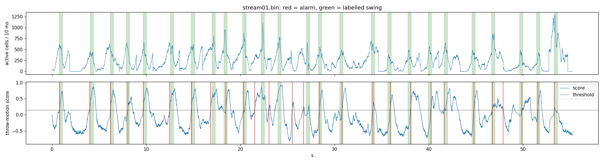

# Throw-motion detector (binary SNN, board format)

**TL;DR for the morning**
1. **Models:** `throwdet/models/`, board files plus the readout. Test them in the order **D, E, A, B, C**.
2. **Board:** flash `weights.txt`, `model.json` and `config.yaml` like the earlier SNN (`training/export_snn.py` layout). Input 2x80x80 binary at 10 ms, output 2 neurons.
3. **Host:** run `live_readout.py` with the model's `readout.json` on the two output spike counts per frame. An alarm means a throw motion has started; trigger the dodge.
4. **Before the demo:** record 1 to 2 minutes at the site and check them with `replay.py`.
   - Too many false alarms (people walking close to the camera are the usual cause): switch to `readout_fa1.0.json`, or adapt with `cut_recording.py --idle` plus `adapt.sh` (about 5 to 10 min on the A100).
   - Throws missed: use `readout_fa4.0.json`.
5. **What to expect** (out of fold, new recordings): about 70 % of throw motions detected at about 2 false alarms per minute, the alarm about 150 ms before the release. Throws and feints both count as throw motion. A new setup, e.g. the thrower at the image edge, is the main risk.

**Question the network answers, every 10 ms in the live feed: is a throw motion happening right now?**
A real throw and a feint both count as throw motion (the arm swings like a throw). Everything
else does not: standing, walking, waving, an empty scene. Deciding whether the ball is actually
released is a separate task (see `pretrain/` and `~/robust` on the Tim branch).

Status: six candidate models are ready for the live test, see **Models to test live**.
Experiments ran overnight on 21/22 Nov; the results table is below.

## Models to test live

`throwdet/models/<name>/`; the same files are on the A100 in `~/throwdet/deliver/<name>/`. All three
use the board format. A, B and C are trained on all our data (all recordings, synth, video, DailyDVS); D on three quarters of our recordings plus all external data.

**Test in this order: D, E, A, B, C** (E2 is a spare).

| name | training config (CV run) | why test it |
|---|---|---|
| `D_e10_fold3` | e10, the CV model of fold 3: trained on recordings 02, 03, 04 (incl. the setup closest to the demo), idle chunks 0 to 2 and all external data | the only candidate whose threshold was picked out of fold for exactly this network; on the unseen 01 recordings it detected 23 of 25 swings with 4 other alarms in 55 s (plot below) |
| `E_moredd` | e26: as e10 but twice the DailyDVS share (dd 20 %/20 %, own 15 %/25 %, synth 5 %/5 %), trained on all data | over 4 seeds as good as e10 and slightly more stable: AUC 0.88 to 0.92, mean 0.90; recall at 2 FA/min 0.58 to 0.82, mean 0.71 (e10: 0.865 to 0.924, mean 0.89; recall 0.54 to 0.79, mean 0.65). On the 01 stream: 24 of 25 swings, 3 other alarms (01 is in its training set) |
| `E2_moredd_fold3` | e26 seed 1, the CV model of fold 3 (like D) | spare; its threshold is out of fold for this network, but on the unseen 01 stream it found only 21 of 25 swings with 7 other alarms |
| `A_neg` | e10: own negatives weighted up (own:0 = 30 %) | best out-of-fold result (AUC 0.92, 79 % recall at 2 false alarms/min), but a second seed of the same config reached only 0.87 |
| `B_neg_shiftx` | e18: as A, plus horizontal shift ±25 px | the same recipe, more robust when the thrower stands near the image edge; AUC 0.93 on the held-out recording `04` |
| `C_all` | e01: balanced domains, DailyDVS thinned to our density | the first, plain recipe; second-best CV (AUC 0.90) |

Each folder contains:
- **For the board:** `model.json`, `weights.txt`, `config.yaml`. Same layout as `training/export_snn.py`; confirm the weight order with Durance before flashing.
- **`model.pt`:** float checkpoint for `replay.py` and `adapt.sh`.
- **`readout.json`:** the live rule at the default operating point of about 2 false alarms per minute.
- **`readout_fa1.0.json` / `readout_fa4.0.json`:** stricter (about 1 per minute) and more sensitive (about 4 per minute) variants of the same model. Only alpha, threshold and hold change, so no re-export is needed.
- **`readout_cal_fa*.json`** (A, B, C only): the same readouts with the threshold recalibrated by `calibrate.py`. It matches the CV models' alarm rate on DailyDVS persons that no model has seen. On the 01 stream this was neither clearly better nor clearly worse, so the default stays `readout.json`.
- **`cv_readout.txt`:** out-of-fold numbers of the CV run behind it, per recording.

### Live readout (host side, every 10 ms frame)

```
d     = spikes[1] - spikes[0]                 # output neuron 1 = throw motion, 0 = none
score = (1 - alpha) * score + alpha * d       # never reset
above = score > threshold
alarm when `above` holds for `hold_frames` consecutive frames, then ignore alarms for 1 s
```

`live_readout.py` implements exactly this rule (pure Python, no dependencies): `ThrowReadout(readout.json).update(s0, s1)` once per frame returns True when an alarm fires. On the 01 stream it gives the same alarm times as `replay.py`; the only difference is 10 ms of frame numbering.

**Noise filter on the board.** despot filters noise (`noise_filtering_factor: 0.5` in `metavision_camera.json`). Our training recordings come from `river-tools capture` and are probably unfiltered, so live input has fewer isolated noise events than training. The models were trained with extra random noise cells, so this should be harmless. If live behaviour looks off, try a higher factor (less filtering) first.

Expected timing: the alarm comes during the wind-up, roughly 150 ms before the swing peak.

### What it looks like live



The 25 short recordings of `dataset/01` were played back to back as one 55 s stream (`replay.py`) through the e10 model of the CV fold that did **not** train on them, with the default readout:
- **23 of 25 swings** got an alarm within -0.6..+0.3 s of the swing peak.
- 3 more alarms fired. Some come at the hard cuts between the concatenated files, some well before a swing.

The three final models (trained on all data, so 01 is in their training set) with their CV-picked readouts:

| model | swings detected (-1.0..+0.3 s) | other alarms in 55 s |
|---|---|---|
| D (01 not in training) | 24 / 25 | 3 |
| E | 24 / 25 | 3 |
| E2 (01 not in training) | 21 / 25 | 7 |
| A | 25 / 25 | 2 |
| B | 24 / 25 | 6 |
| C | 21 / 25 | 5 |

The threshold picked on the CV models does not transfer exactly to a newly trained model. Check it with `replay.py` on a site recording, and move to `readout_fa1.0.json` (stricter) or `readout_fa4.0.json` (more sensitive) if needed.

### Integration with the dodge (Tim branch, `sim/deploy/`)

Today the dodge is triggered by hand: a key (`l`/`d`/`r`) or a button. The detector only has to call that trigger when an alarm fires. That needs a thin bridge on the host that reads the board output, applies the readout above and sends the trigger. The dodge controller itself does not change.

Timing budget:
- **Alarm:** at the default readout it fires about 150 to 180 ms before the swing peak (about the release). The sensitive readout `readout_fa4.0.json` fires about 180 to 210 ms before it, at the cost of more false alarms.
- **Dodge:** the SAFE dodge needs about 0.6 s to move 30 cm (sim, `results/safe_dodge.json`) and refuses unless the dog has stood still for at least 1 s.
- **Ball:** thrown from 2 to 3 m at roughly 8 m/s, it is in the air for about 0.3 s.

So the dodge starts about 0.45 s before impact. A shorter or faster first sideways step helps more than a lower detection threshold.

### Before the demo: check and, if needed, adapt to the site (5 to 10 min)

1. **Check** a recording made at the site:
   `python throwdet/replay.py throwdet/models/A_neg/model.pt rec.bin --readout throwdet/models/A_neg/readout.json`.
   It prints the alarm times and writes a plot of event rate, score and alarms.
2. **Too many false alarms** (people walking by, a different background)? Record 2 to 3 minutes of the site **without throws**, with people moving around. Then on the A100:
   ```bash
   python throwdet/cut_recording.py --idle site_idle.bin --out ~/throwdet/site
   bash throwdet/adapt.sh ~/throwdet/deliver/A_neg ~/throwdet/site A_site
   ```
   That fine-tunes for about 5 minutes with the site clips as 40 % of every batch and exports to `~/throwdet/deliver/A_site/`.
3. **Throws missed** (new thrower position or distance)? Record with `tools/record_tool.py` from the noah branch: press Space after each throw and `k` after each feint. Then add `--hints <dir>/hints.csv --pauses` to `cut_recording.py`. The swing is found automatically as the event-rate peak in the 2 s before the key press.


## Board format

Same as `pretrain/` on the Tim branch, so it runs on the KV260:

| | |
|---|---|
| Input | binary `[T, 2, 80, 80]`: 10 ms frames, a 4x4 block of the 320x320 GenX320 image is 1 if any event of that polarity fell into it (despot `downsampling: 4`, `frequency: 100`) |
| Network | spiking conv layers only (riverops `SpikingConvBN2d`, head `SpikingConv2d` -> `[T, 2, 1, 1]`) |
| Output | 2 neurons: 0 = no throw motion, 1 = throw motion |
| Live readout (host) | `score_t = (1 - alpha) * score_{t-1} + alpha * (spike1_t - spike0_t)`, alarm when `score_t > threshold`, then 1 s refractory. `alpha` and `threshold` are in each model's `readout.json` |

The network state is never reset in live use. Training uses random 0.8 s windows cut from 1.2 s clips, so the model never relies on starting from a reset state.

## Data (`prep.py` builds one table, 5,615 clips of 1.2 s)

| Domain | Source | throw motion (1) | no throw motion (0) |
|---|---|---|---|
| own | our GenX320 recordings, noah branch `dataset/_dataset01_01020304` | 77 throws + 104 feints | 288 idle clips (the 5:47 min idle recording `04/211821`) |
| own | noah branch `dataset/_dataset01_010203`, idle only | | 255 idle clips (pauses between the swings, person in view) |
| own_aug | `dataset/build/aug_train`, `splice_train` (derived from the 01 recordings) | 423 | 108 |
| sim | `dataset/build/synth_train` (synth v2) + `video_train` (phone videos) | 832 | 416 |
| dd | DailyDVS-200 (real DVS, 47 people, MIT licence), `tools/dailydvs_import.py` | 590: throwing ball, pitch, throw things, toss | 2,522: arm swings without release (badminton swing, punch, wave, point, ...) and everyday idle actions |

The motion clips have the decision moment (event-rate peak of the swing) at 0.7 s. Targets per 10 ms frame:
- **Motion clips:** 1 from 250 ms before the peak to 300 ms after it. Our labels put the wind-up start at a median of 250 ms before the peak. All other frames of a motion clip are ignored.
- **Other clips:** 0 on every frame after a 150 ms warm-up.

## Avoiding shortcuts

Plain features already tell the domains apart: a logistic regression on activity features identifies DailyDVS vs. our camera with 93 % accuracy (`baseline.py`). DailyDVS is mostly negatives and our data mostly positives, so a careless model would learn "DailyDVS look = no throw". Countermeasures in `train.py`:
- **Balanced sampling.** Each (domain, target) pair gets a fixed share of every batch, for example own:1 = own:0 = 20 % and dd:1 = dd:0 = 15 %, so the domain carries no information about the target.
- **Density matching.** DailyDVS, synth and aug clips are randomly thinned to the active-cell density of our camera (30 to 200 cells per frame). Untouched, DailyDVS has about 270 to 470 cells per frame, our camera about 25 to 85.
- **Background compositing.** In half of the external clips, one of our own idle clips is OR-ed in, so they carry our scene and sensor noise.
- **Augmentation.** Mirror, scale ±25 %, shift ±8 px, time shift ±150 ms, speed ±20 %, cell dropout and noise.

## Evaluation (never used to pick a checkpoint: the model after the last step is evaluated)

- **Own camera, grouped 4-fold CV by recording.** The idle recording is split into 4 contiguous time chunks. Aug and splice clips derived from held-out recordings are removed from training. Reported:
  - balanced accuracy at the clip level: a motion clip counts as detected if the score crosses the threshold within -250..+300 ms of the peak, an idle clip is a false alarm if the score crosses anywhere
  - AUC
  - detection latency relative to the peak
- **Live stream.** Each held-out chunk of the idle recording is played as one continuous stream, giving false alarms per minute.
- **DailyDVS held-out persons** (official val/test persons): generalisation to new people, scenes and a different sensor.

Reference: `baseline.py`, a logistic regression on the activity curve, reaches 77 % balanced accuracy on the own-camera CV. A model has to beat that clearly; otherwise it has only learned "much motion = throw".

## Files

| File | Purpose |
|---|---|
| `prep.py` | builds `~/throwdet/data/table.npz` from all sources (`--own-new` adds site clips) |
| `train.py` | training plus grouped CV, live-stream false-alarm test, DailyDVS person holdout. Options: `--folds 0` for a final model, `--resume` for adaptation, `--qat-steps` for QAT |
| `eval_readout.py` | readout sweep (alpha, hold, threshold) on the out-of-fold predictions at four false-alarm budgets, plus a per-recording breakdown |
| `summary.py`, `auto_eval.sh` | comparison table over all runs (`results_summary.md`); evaluates every finished run automatically |
| `analyze.py` | older per-run summary from `result.json` (score curves, per recording) |
| `baseline.py` | non-spiking reference and domain probe |
| `export.py` | `model.json`, `weights.txt`, `config.yaml`, `readout.json` for the Kria, plus the float vs fixed-point check |
| `finalize.sh` | exports a final model with the readouts of its CV run at three false-alarm budgets |
| `calibrate.py` | re-calibrates a final model's threshold on unseen DailyDVS persons (`readout_cal_*.json`) |
| `live_readout.py` | host-side live rule (board spikes -> alarm), drop-in for the live pipeline |
| `replay.py` | runs a recording of any length through a model exactly like the live loop; writes alarm times and a plot |
| `cut_recording.py`, `adapt.sh` | cut site recordings into clips and fine-tune a delivered model on them |
| `soup.py` | weight averaging of runs (tested, does not help) |
| `worker.sh` | job queue on the A100 (`~/throwdet/queue.txt`) |
| `model.py`, `speedpatch.py` | copied from `pretrain/` on the Tim branch |
| `models/` | the candidate models for the live test |

## Results

All numbers are out of fold on our own camera: 724 clips, 181 of them with throw motion, grouped 4-fold CV by recording. They also include the held-out idle stream (5.8 min, with people walking through the view).
- **Recall @k FA/min:** the share of throw motions (throws and feints) detected between 250 ms before and 300 ms after the swing peak. It uses the best readout (alpha, hold, threshold) that stays within k alarms per minute on the idle stream and within the matching idle-clip budget.
- **Full table of all 37 runs:** `results_summary.md`, regenerated on the A100 in `~/throwdet/summary.md`.

**Read this first: seed-to-seed variance is large.** The same configuration trained with a different random seed moves the AUC by up to 0.06 and the recall at 2 FA/min by up to 0.25. Most of it comes from the fold that holds out recording `04` (a new setup). Single-run differences below about 0.04 AUC mean nothing.

| configuration | runs (seeds) | AUC own | recall @1 FA/min | recall @2 FA/min | recall @4 FA/min |
|---|---|---|---|---|---|
| activity baseline (logistic regression on the activity curve, not an SNN) | 1 | bal. acc 0.77 | | | |
| **e10: all sources, own negatives weighted up (own:0 = 30 %), DailyDVS unthinned** | 4 (+1 with 2000 steps) | **0.865 to 0.924** (mean 0.89) | 0.10 to 0.64 | **0.54 to 0.79** (mean 0.65) | 0.73 to 0.90 |
| **e26: e10 with twice the DailyDVS share** | 4 | **0.881 to 0.919** (mean 0.90) | 0.08 to 0.58 | **0.58 to 0.82** (mean 0.71) | 0.82 to 0.90 |
| e01: all sources, balanced, DailyDVS density-matched | 2 | 0.852 to 0.903 | 0.33 to 0.42 | 0.59 to 0.72 | 0.81 to 0.88 |
| e10 + DailyDVS static-camera clips only | 2 | 0.886 to 0.888 | 0.48 to 0.54 | 0.73 to 0.75 | 0.82 to 0.83 |
| e10 + readout alpha 0.05 in training | 2 | 0.864 to 0.890 | 0.37 to 0.51 | 0.69 to 0.72 | 0.84 to 0.87 |
| e10 + cell dropout up to 50 % | 2 | 0.801 to 0.883 | 0.24 to 0.44 | 0.60 to 0.63 | 0.78 to 0.87 |
| e10 without the aug/splice clips | 2 | 0.734 to 0.897 | 0.18 | 0.43 to 0.56 | 0.61 to 0.81 |
| **e10 without synth and video** | 2 | **0.826 to 0.846** | 0.18 to 0.28 | 0.55 to 0.65 | 0.76 to 0.80 |
| own clips + own aug only (e02) | 1 | 0.845 | 0.39 | 0.62 | 0.73 |

Single runs (one seed each, so only large differences count):

| run | change | AUC own | recall @2 FA/min |
|---|---|---|---|
| e18 / e16 | horizontal shift ±25 px (on e10 / on e11) | 0.896 / 0.907 | 0.73 / 0.69 |
| e11 | hard-negative sampling (dense idle clips more often) | 0.892 | 0.70 |
| e25 | e10 without background compositing | 0.878 | 0.67 |
| e03 | e01 without DVS-Gesture pretraining | 0.861 | 0.59 |
| e04 | e01 without DailyDVS arm-swing negatives | 0.878 | 0.58 |
| e06 | motion label from 400 ms instead of 250 ms before the peak | 0.873 | 0.68 |
| e07 / e13 | larger "mid" backbone | 0.859 / 0.863 | 0.64 / 0.71 |
| e12 | neuron tau 4 instead of 2 | 0.866 | 0.61 |
| e08 / e21 | 2400 / 2000 steps instead of 1200 | 0.862 / 0.900 | 0.63 / 0.69 |
| e32 | full 1.2 s windows instead of random 0.8 s crops | 0.854 | 0.58 |
| e19 | own negatives at 40 % | 0.857 | 0.51 |
| e17 | e01 + horizontal shift ±25 px | 0.830 | 0.34 |
| s10 | weight average of two e10 seeds | 0.865 | 0.70 |

What holds up:
- **The two best recipes are e10 and e26, and they are about equal.** e26 is a little better on average (mean recall at 2 FA/min 0.71 vs 0.65), but that is within the seed spread.
- **External data helps on new recordings.** With own data only, the fold that holds out recording `04` drops to an AUC of 0.75; with synth, video and DailyDVS it is 0.85 to 0.94. Synth and video in particular: removing them made both seeds worse than every e10 seed.
- **People walking close to the camera cause almost all false alarms.** So do hands right in front of the lens. An empty scene and whole-image motion do not trigger alarms.
- **The hardest case is a new setup.** In recording `04/215305` the thrower stands at the left image edge and part of the swing leaves the view. The `03` recordings are detected 100 %; `04` only 40 to 65 % when it is held out. The final models have `04` in training.
- **Nothing beat the plain v1 backbone with 1200 steps.** Not bigger backbones, not a longer neuron time constant, not longer training, not full windows, not weight averaging.

What is not clear (within the seed noise): DVS-Gesture pretraining, the DailyDVS arm-swing negatives, density matching, hard-negative sampling, horizontal shift and the aug/splice clips. All of them changed one or two runs by less than the seed spread.

**Fixed point.** PTQ to 8-bit weights (Q3.5) and Q4.12 potentials keeps 94 to 98 % of the alarm decisions (`ptq_check` in each `readout.json`). `--qat-steps` adds quantization-aware fine-tuning. It works and the checkpoint exports unchanged, but it is slow (about 11 s per step) and was not needed.

**Detection time.** At the 2 FA/min operating point, the alarm comes about 150 to 180 ms before the swing peak, i.e. during the wind-up.
